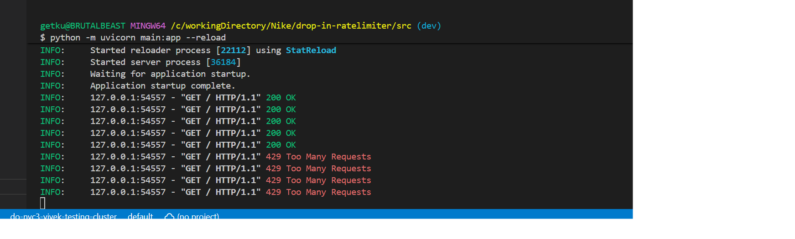

# drop-in-ratelimiter
The repository for a sneaker drop in rate limiter solution for a leading brand
# PRerequisites
  Bash

pip install fastapi uvicorn redis

# How to run and test it

# Start Redis Locally
docker run -d  -p 6379:6379 redis

# Run the FastAPi application using Uvicorn

uvicorn main:app --reload 

# Test The Endpoints 

Browser or command line: curl -i [http://127.0.0.1:8000/](http://127.0.0.1:8000/) 

# Check  :
After 5 requests within a minute, you will receive an HTTP 429 Too Many Requests response with the Retry-After header telling you how many seconds to wait.

